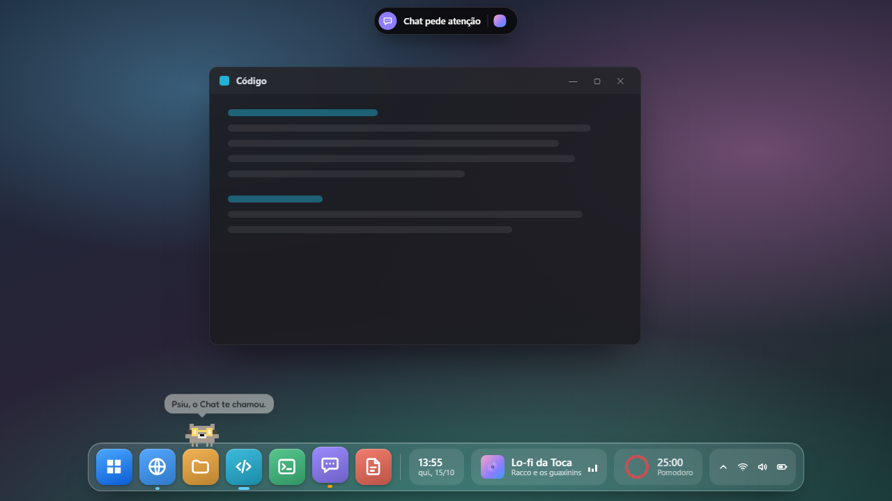
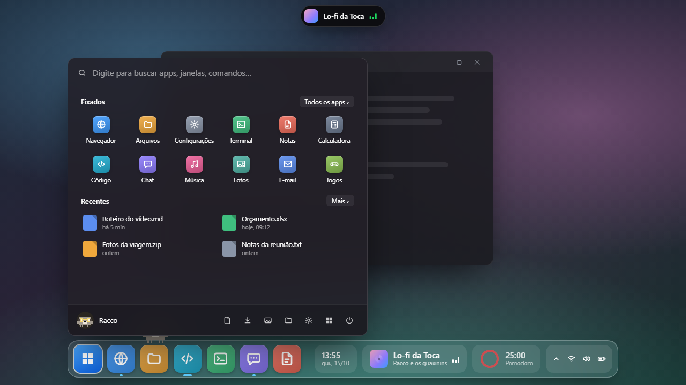
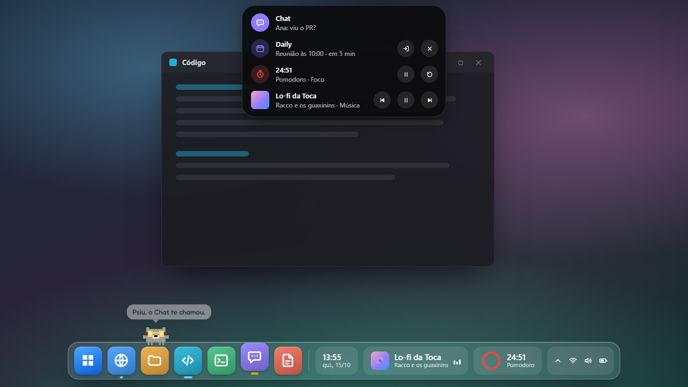

# Toca

Um dock para o Windows 10 e 11 que substitui a barra de tarefas, com o Racco morando nele.

**[toca.suiciniv.dev](https://toca.suiciniv.dev)** · [Baixar a versão mais nova](https://github.com/suiciniv-dev/toca-releases/releases/latest) · [English](#english)

Este repositório guarda só os instaladores e as notas de cada versão. O código é fechado.

## O que ela faz

- Apps e janelas no dock, com miniaturas ao vivo, rodinha para passar pelas janelas e Win+1 a Win+9.
- Os ícones de segundo plano (Discord, Bluetooth, antivírus) na seta da Toca, como na barra do Windows.
- O Iniciar da Toca na tecla Windows: fixados, recentes, pastas e energia; é só digitar para buscar.
- A Ilha no alto da tela, com a música tocando, o pomodoro, o cronômetro, a reunião chegando e o app que pede atenção.
- Widgets vivos, os seus por script, dez estilos de ícone e nove temas de barra.
- O Racco anda pela barra, avisa o que importa e troca de acessório com o ambiente.

## Instalar

Baixe o `Toca-Setup-<versão>.exe` em [Releases](https://github.com/suiciniv-dev/toca-releases/releases/latest). Funciona no Windows 10 (2004 ou mais novo) e 11, x64, e instala só no seu usuário, sem administrador. O instalador não tem assinatura paga, então o Windows avisa na primeira vez: Mais informações › Executar assim mesmo.

São 7 dias com tudo liberado. Depois, o dock, as janelas, a bandeja, o relógio e o Racco continuam grátis, e os extras pedem a licença: R$ 7,50, uma vez só, para sempre e em qualquer PC. Compra, ajuda e recuperação da chave ficam no [site](https://toca.suiciniv.dev).

## English

A dock for Windows 10 and 11 that replaces the taskbar, with the Racco living in it: apps and windows, background icons, its own Start menu, an Island at the top of the screen, live widgets, ten icon styles and nine themes. Download the installer from [Releases](https://github.com/suiciniv-dev/toca-releases/releases/latest). It comes with a 7-day trial with everything unlocked; after that the basics stay free and a one-time R$ 7.50 license unlocks the extras on all your PCs. More at [toca.suiciniv.dev/en](https://toca.suiciniv.dev/en/).
